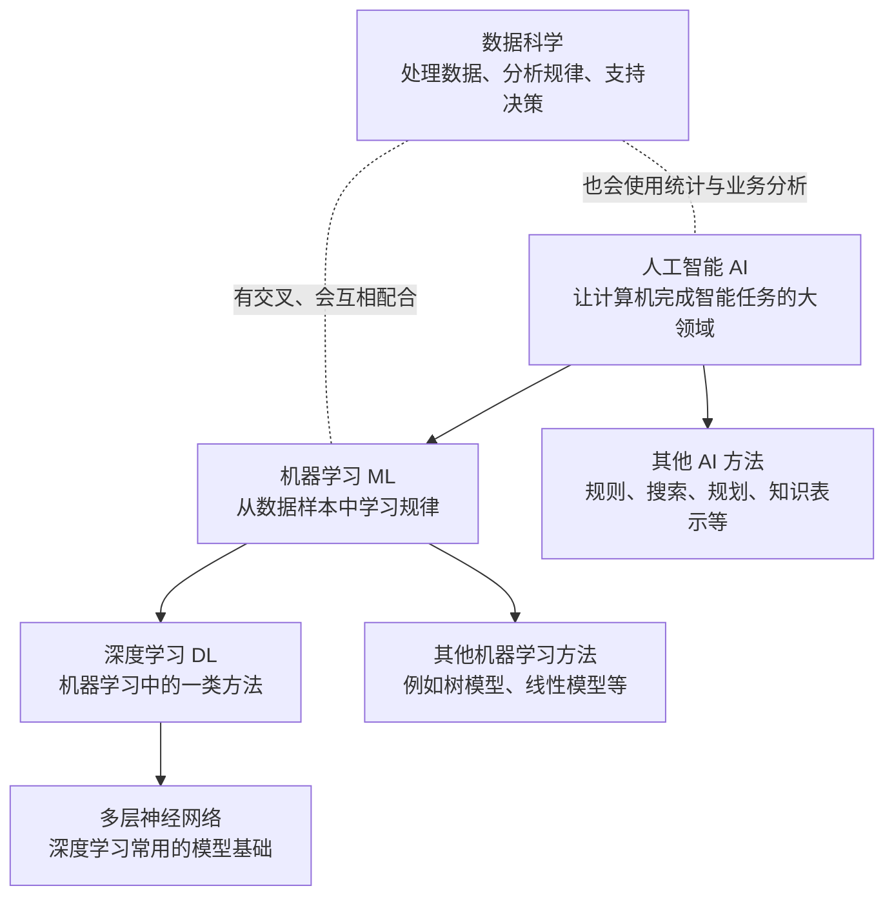
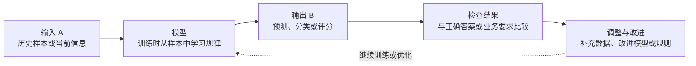
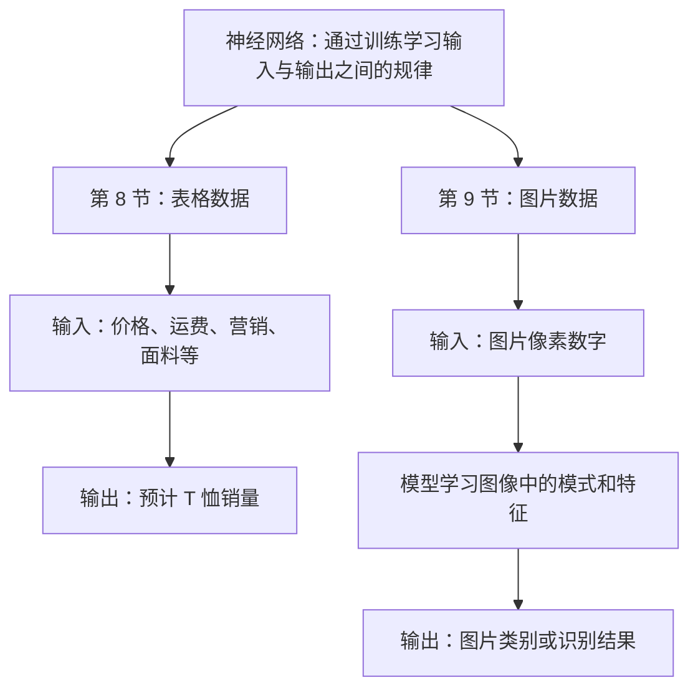

# 模块一知识地图：从认识 AI 到理解神经网络

> 适用对象：刚开始学习人工智能、没有编程基础的普通学习者  
> 对应课程：吴恩达《AI For Everyone》模块一，第 1—9 节  
> 整理日期：2026-11-07  
> 使用方法：先看总图，再沿着“概念关系—工作流程—课程例子”阅读。遇到不懂的词，可以回到对应视频笔记。

## 一、先看全貌：这些概念是什么关系？

**用一句话记住：**

- AI 是大领域；
- 机器学习是 AI 的重要方法之一；
- 深度学习是机器学习中的一类方法；
- 多层神经网络是深度学习常用的技术基础；
- 数据科学与 AI、机器学习有交叉，但不是简单地被包含在 AI 里面。

这是一张帮助初学者理解的概念图，不是严格的数学分类图。现实工作中，不同团队对“AI”“数据科学”的使用范围可能略有不同。

## 二、把概念放进生活里理解

想象你经营一家网店：

- 你希望电脑根据商品价格、运费、宣传情况，估算明天能卖出多少件。这是一个机器学习预测任务。
- 你希望分析过去半年哪些商品卖得最好、哪些促销方式效果更好，并写出经营建议。这更接近数据分析或数据科学工作。
- 你希望系统理解顾客的问题、查找订单信息、生成回复并在必要时交给客服处理。这可能需要多种 AI 方法和软件功能配合，不能简单理解为“一个神经网络就能解决全部问题”。

同一家公司可以同时使用机器学习、数据科学和其他 AI 技术。它们不是互相排斥的选择。

## 三、机器学习的基本工作方式：输入 A → 输出 B

例如，预测 T 恤销量：

| 输入 A（提供给模型的信息） | 输出 B（希望得到的结果） |
|---|---|
| 售价、运费、宣传情况、面料等 | 预计销量 |

这里的中间关系可能很复杂。神经网络可以在训练过程中调整内部参数，学习多个因素与销量之间的关系。人不必逐条写出所有中间规则，但仍需要准备合适的数据、定义任务，并检查结果。

## 四、第 8、9 节为什么放在一起？

两节选修视频用不同类型的输入，帮助我们理解神经网络可以处理不同问题。

### 第 8 节：T 恤销量预测

可以把它理解成：给模型一些与销量有关的信息，让模型从历史例子中学习这些信息与销量之间的关系。

### 第 9 节：图片识别

人看到照片，会自然注意到眼睛、鼻子、轮廓等内容；计算机接收到的首先是像素数值。模型通过大量图片和对应标签学习有用的图像模式，再对新图片给出判断。

**两节的共同点：** 输入形式不同，但都在说明模型如何通过训练学习规律。图片识别与图片生成是不同任务，不要混为一谈。

## 五、数据在整条路线中扮演什么角色？

数据不是越多越好，关键是与任务相关、质量合格，并且能代表真实使用情况。

| 数据要点 | 普通话解释 | 生活例子 |
|---|---|---|
| 输入 | 提供给模型的信息 | 商品价格、图片、客户邮件 |
| 输出 / 标签 | 希望模型学会给出的正确答案 | 实际销量、图片类别、邮件类别 |
| 数据质量 | 信息是否真实、完整、准确 | 商品价格不能填错，图片不能严重模糊 |
| 代表性 | 样本是否覆盖真实变化 | 不能只用晴天照片训练，却要求模型应对雨雪 |
| 训练 | 用样本调整模型 | 让模型反复学习历史例子 |
| 推理 | 用训练好的模型处理新信息 | 输入新商品信息，估算销量 |
| 泛化 | 面对没见过的新情况，是否仍能做好 | 换一家医院或一款新相机，识别效果是否仍可靠 |

## 六、从第 1 节到第 9 节：每节在知识地图中的位置

| 视频 | 学到什么 | 在整张地图中的作用 |
|---|---|---|
| 01 第一周导论 | AI 的范围、专用 AI 与通用 AI 等基本认识 | 先建立全局视角 |
| 02 机器学习 | 输入 A 到输出 B、监督学习 | 认识机器学习的基本方式 |
| 03 什么是数据 | 数据集、数据类型、数据质量 | 明白模型学习需要什么材料 |
| 04 AI 术语 | AI、机器学习、数据科学、神经网络、深度学习 | 分清容易混淆的名词 |
| 05 什么样的公司善于运用 AI | 数据能力、团队、组织流程 | 理解 AI 如何进入真实业务 |
| 06 机器学习能做什么、不能做什么 | 一秒钟经验法则、任务难度和数据条件 | 学会判断任务是否适合机器学习 |
| 07 更多能力边界案例 | 自动驾驶、医疗影像、泛化 | 理解真实环境中的限制与风险 |
| 08 深度学习解释（上） | T 恤销量、神经网络学习中间规律 | 从表格数据理解神经网络 |
| 09 深度学习解释（下） | 像素、图像特征、训练标签 | 从图片识别理解神经网络 |

## 七、遇到一个实际问题，怎样初步判断该怎么做？

可以先问自己五个问题：

1. **我到底想解决什么？** 不要只说“用 AI 帮我处理”，要说清楚具体任务。
2. **输入是什么？** 是表格、文字、图片、声音，还是多种信息？
3. **希望得到什么结果？** 是预测一个数字、分成几类、找出规律，还是生成一份内容？
4. **有没有可用的例子和正确答案？** 如果希望模型学习分类或预测，是否有质量合格的历史样本？
5. **错了会有什么后果？** 普通分类可以人工改正；涉及付款、医疗、重要文件或删除操作，就必须增加审核和安全措施。

初步判断示例：

| 真实需求 | 可以先考虑的方式 | 为什么 |
|---|---|---|
| 根据文件扩展名识别 PDF、图片、表格 | 普通规则或软件功能 | 规则明确，不一定需要机器学习 |
| 根据资料标题和摘要推荐分类 | AI 辅助分类，人工确认 | 内容可能有歧义，需要检查 |
| 统计哪类资料增长最快 | 数据分析 | 重点是统计和发现趋势 |
| 根据历史销量预测库存 | 机器学习预测 | 有历史数据，目标相对明确 |
| 自动决定删除哪些私人文件 | 不应直接交给 AI 自动执行 | 错误代价高，应由人确认 |

## 八、最容易混淆的六件事

1. **AI 不等于机器学习。** 机器学习只是 AI 的重要方法之一。
2. **机器学习不等于深度学习。** 还有许多不使用深度神经网络的方法。
3. **神经网络不等于人脑。** 名字有历史联系，但计算机制并不相同。
4. **数据科学不只是训练模型。** 它也包括数据整理、统计分析、实验和业务解释。
5. **训练不等于使用。** 训练是让模型从样本中调整参数；推理是用训练好的模型处理新输入。
6. **识别不等于生成。** 识别是判断输入图片里有什么；生成是根据条件创造新图片。

## 九、学习完成后的自测

试着不看前面的解释，回答以下问题：

- AI、机器学习和深度学习是什么关系？
- 为什么数据科学不宜被简单画成 AI 的子集？
- T 恤销量预测的输入 A 和输出 B 分别是什么？
- 电脑为什么需要把图片转换成像素数字来处理？
- 为什么模型在训练数据上表现好，不代表换一个环境仍然可靠？
- 如果让 AI 自动整理你的学习资料，哪些步骤可以先交给 AI，哪些步骤必须由你确认？

如果能用自己的话回答这些问题，就说明你已经掌握了模块一最重要的主线。

## 十、与课程原意和现代技术的边界

本知识地图主要归纳吴恩达课程第 1—9 节的基础概念。第 8、9 节的 T 恤销量和图片识别例子属于课程讲解重点；表格中的辅助说明和个人资料库案例是为了帮助理解而增加的内容。

CNN、视觉 Transformer、多模态 AI、生成式图像模型等属于课程之后的现代技术延伸，不应误认为是早期课程视频原本讲授的内容。现代模型能力也不能只靠一个简单的“一秒钟规则”判断。

## 相关笔记

- [模块一：什么是 AI？](01-什么是AI.md)
- [视频 01—09 逐节笔记](README.md)
- [35 节逐课学习清单](05-35节逐课学习清单.md)
- [模块一第二轮校验记录](06-模块一第二轮校验记录.md)
