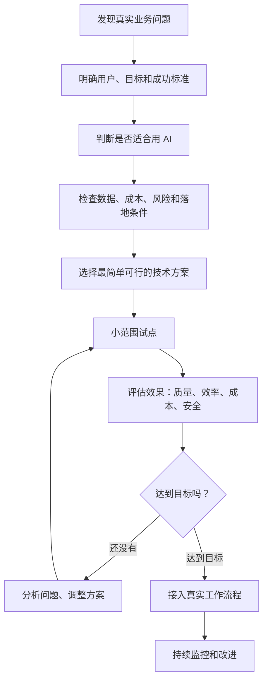
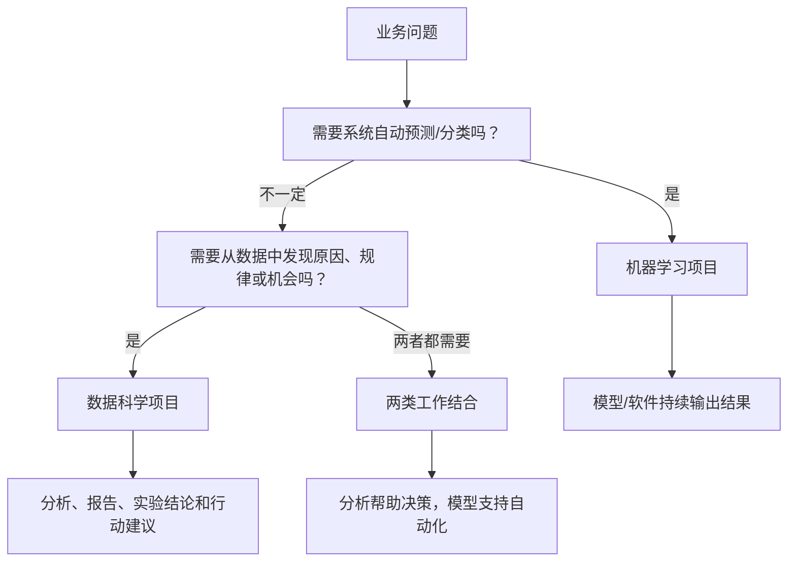
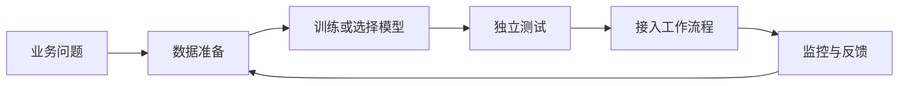

# 模块二知识地图：怎样把 AI 想法变成真正有用的项目

> 对应课程：吴恩达《AI For Everyone》模块二，第 10—17 节  
> 整理日期：2026-11-07  
> 适用对象：希望了解 AI 项目如何从想法走向实际应用的普通学习者

## 一、先看全貌：AI 项目不是从挑选模型开始

**最重要的一句话：先解决问题，再决定用什么 AI。**

不要因为某个工具很热门，就硬找一个问题来使用它。项目成功不仅取决于模型，还取决于数据、流程、团队、成本、用户是否愿意使用，以及出错时如何处理。

## 二、两条常见路线：机器学习项目与数据科学项目

| 比较 | 机器学习项目 | 数据科学项目 |
|---|---|---|
| 主要目的 | 让系统自动预测、分类或评分 | 从数据中发现规律，支持决策 |
| 常见交付物 | 可运行的模型或软件功能 | 分析结果、报告、实验和建议 |
| 例子 | 预测明天某商品销量 | 分析哪些促销方式更有效 |
| 是否一定需要模型 | 通常需要 | 不一定 |

两者可以在同一项目中合作，不必把它们看成互相排斥的选择。

## 三、机器学习项目的基本流程

1. **明确问题：** 要改善哪个业务环节？谁会使用结果？
2. **准备数据：** 数据从哪里来？是否合法、准确、足够？
3. **定义输入和输出：** 给模型什么信息？希望它回答什么？
4. **选择或训练模型：** 先考虑现成工具，再判断是否需要专门训练。
5. **独立评估：** 用没有参与训练的样本测试，避免只看训练时的表现。
6. **部署使用：** 把结果接入真实流程，而不只是做一个演示。
7. **持续监控：** 观察错误、用户反馈、数据变化和维护成本。

模型训练只是其中一环。一个模型即使测试分数很好，如果不能接入系统、用户不信任、成本太高或无人维护，项目仍可能失败。

## 四、数据科学项目：从数据走向行动

可以用网店经营来理解：

- 先问一个具体问题：为什么上个月某类商品销量下降？
- 收集订单、价格、促销、库存和时间等相关数据。
- 通过统计、图表和比较寻找可能原因。
- 提出假设，例如库存不足或价格变化影响销量。
- 通过进一步数据或实验验证，而不是把相关关系直接当成原因。
- 将结论转成行动，再观察行动是否有效。

**数据分析发现“两个事情一起发生”，不等于证明其中一个导致另一个。** 要判断原因，可能需要实验、对照组或更严谨的分析。

## 五、所有岗位都需要一定的数据意识

数据能力不只是工程师的工作。

| 岗位 | 可以怎样使用数据 |
|---|---|
| 销售 | 看客户来源、成交率和跟进效果 |
| 市场 | 比较不同广告活动带来的结果 |
| 运营 | 找出订单延迟和客户投诉集中的环节 |
| 财务 | 识别费用变化和异常支出 |
| 招聘 | 分析招聘渠道和流程效率，同时检查公平性 |
| 管理者 | 用可靠指标判断项目是否达到目标 |

每个人不必都会编程，但应学会提出问题、看懂指标、发现数据缺失，并追问结论是否有证据。

## 六、怎样挑选值得做的 AI 项目？

可以用“价值、可行、可控”三个方向筛选：

- **有价值吗？** 能省时间、降成本、提高质量，还是改善客户体验？
- **做得到吗？** 有合适的数据、技术、人员和系统条件吗？
- **风险可控吗？** 出错会造成什么影响？能否人工复核和撤回？

优先从范围小、重复频繁、结果容易检查的工作开始。例如先让 AI 给客服邮件分类，而不是一开始就让它独立处理所有客户投诉、退款和付款。

## 七、业务人员怎样和 AI 团队合作？

业务方要说清楚：
- 谁会使用这个功能；
- 现在的工作流程是什么；
- 最想改善哪一步；
- 什么结果算成功；
- 哪些错误不能接受；
- 谁负责检查异常结果。

技术团队负责评估数据、技术方案、测试方法、部署和维护。双方需要共同确定验收标准，不能只交给技术人员一句“帮我做个 AI”。

## 八、工具选择：工具会变化，基本流程不变

AI 团队可能使用数据处理、模型开发、评估、部署和监控工具。普通学习者不必先背软件名称，先理解工具在流程中负责哪一步。

今天也可以选择调用现成大模型、检索知识库（RAG）或组合工具，而不一定从零训练模型。只有当简单方案不能满足要求时，再考虑更复杂的系统或 Agent。

**现代补充：** 生成式 AI 项目还要测试事实准确性、来源依据、提示注入、隐私、工具权限、成本和多步骤任务稳定性。涉及删除、付款、对外发送信息或修改重要数据时，应保留人工确认。

## 九、用一个普通人的例子串起来：整理个人知识库

假设希望整理电脑里的学习资料：

1. 先定义问题：文件太多，查找困难。
2. 设定目标：自动建议类别、提取标题和摘要。
3. 选择简单方案：先用 AI 阅读文件并提出分类建议，不急着训练模型。
4. 建立验收标准：类别是否正确、摘要是否忠实、是否标出来源。
5. 小批量试用：先拿 20 份文件检查。
6. 纠正错误：记录常见误分类，改进分类说明。
7. 安全保存：保留原文件，重要移动、覆盖和删除由人确认。
8. 观察效果：查找是否更快、重复资料是否减少。

这就是把“想用 AI 整理文件”变成一个目标明确、可测试、可改进的小项目。

## 十、从第 10 节到第 17 节：每节在地图中的位置

| 视频 | 学到什么 | 在项目中的作用 |
|---|---|---|
| 10 第二周导论 | 项目流程、项目选择、数据与团队 | 建立整体路线 |
| 11 机器学习项目流程 | 数据、训练、部署、反馈 | 理解模型项目如何落地 |
| 12 数据科学项目流程 | 探索数据、提出假设、支持行动 | 学会从数据发现问题 |
| 13 每个岗位都要学会使用数据 | 各岗位的数据意识 | 让数据能力进入日常工作 |
| 14 如何选择 AI 项目（上） | 业务价值、技术可行性和任务拆解 | 判断做什么 |
| 15 如何选择 AI 项目（下） | 尽职调查、自建或购买 | 判断怎样做、是否值得 |
| 16 与 AI 团队合作 | 验收标准、数据集和评估 | 让合作有共同标准 |
| 17 AI 技术工具（选修） | 开发工具、论文和开源项目 | 认识实现项目的工具箱 |

## 十一、最容易犯的六个错误

1. 先挑工具，再找用途。
2. 只看模型演示，不测试真实样本。
3. 把相关性误认为因果关系。
4. 只追求准确率，不考虑成本、速度和风险。
5. 把需求全部丢给技术团队，却没有明确验收标准。
6. 认为模型上线就是项目结束，忽略监控、维护和用户反馈。

## 十二、自测题

- 机器学习项目与数据科学项目的交付物有什么不同？
- 为什么模型训练不是 AI 项目的全部？
- 怎样判断一个 AI 想法值得做？
- 为什么试点项目应小而明确？
- 业务人员需要向 AI 团队说明哪些信息？
- 为什么“销量和广告费一起增长”不能直接证明广告费导致销量增长？

## 十三、课程原意与现代补充的边界

本地图归纳第 10—17 节的项目流程、数据科学、数据素养、项目选择、团队协作和技术工具。RAG、生成式 AI、Agent、现代评估与安全治理属于课程之后的实践补充，不应误认为原视频逐字讲授的内容。

## 相关笔记

- [模块二：构建 AI 项目](02-构建AI项目.md)
- [视频 10—17 逐课笔记](README.md)
- [35 节逐课学习清单](05-35节逐课学习清单.md)
- [模块一知识地图](07-第一模块知识地图.md)
