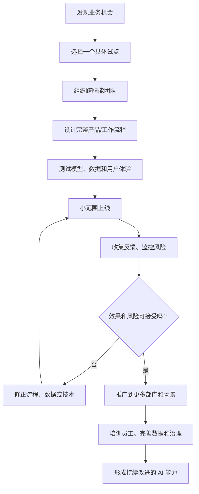
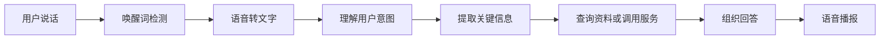
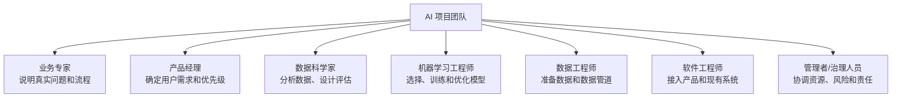
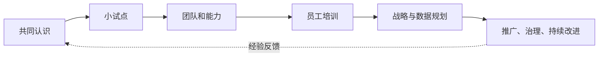

# 模块三知识地图：怎样让 AI 真正进入企业和日常工作

> 对应课程：吴恩达《AI For Everyone》模块三，第 18—27 节  
> 整理日期：2026-11-07  
> 适用对象：希望理解 AI 产品、团队协作和组织转型的普通学习者

## 一、先看全貌：从一个 AI 功能到一套工作方式

**本模块最重要的观点：AI 转型不等于买一个软件，也不等于上线一个模型。** 它意味着把 AI 与员工、数据、产品、流程和管理方式结合起来。

## 二、AI 产品通常是多个环节合作完成的

以智能音箱为例，用户说出一句话后，产品可能需要完成：

这不是一个模型单独完成的魔法。每一步都可能涉及模型、软件、数据、网络和外部服务。某一步准确，不代表整个体验就可靠；还要检查误唤醒、听错、理解错误、服务失败和隐私保护。

**现代补充：** 今天的大语言模型可以承担部分理解、规划和工具调用工作，但仍要限制工具权限、检查调用结果，并在重要操作前要求人工确认。

## 三、复杂系统更需要系统级安全

自动驾驶汽车说明了完整系统的重要性：

- **感知：** 看见车辆、行人、道路和障碍物；
- **定位：** 判断自己处于什么位置；
- **预测：** 推测其他道路参与者可能怎样行动；
- **规划：** 选择下一步路线和动作；
- **控制：** 让车辆实际执行；
- **安全保障：** 遇到传感器异常、恶劣天气或超出设计范围的情况时，安全减速、停车或交由人接管。

一个识别模块准确率高，不代表整辆车在所有道路和天气下都安全。复杂产品必须验证各环节如何协作，以及异常时如何处理。

## 四、一个 AI 团队需要哪些角色？

团队规模不同，一个人可能承担多个角色。重点不是必须招齐所有职位，而是确保这些工作有人负责：业务问题、数据、模型、软件、评估、安全和用户采用。

## 五、企业 AI 转型可以分阶段推进

1. **建立共同认识：** 让管理者和员工知道 AI 能做什么、不能做什么。
2. **选择合适试点：** 找到真实、频繁、可衡量、风险可控的问题。
3. **建立内部能力：** 明确负责人，形成跨部门协作方式。
4. **培训员工：** 不只培训技术人员，也培训业务岗位如何安全使用 AI。
5. **制定战略和数据规划：** 决定优先场景、数据基础、预算和长期目标。
6. **推广并持续改进：** 把验证有效的做法扩展到更多流程，同时监控风险。

转型不是一次性工程，而是持续学习和调整的过程。

## 六、常见 AI 陷阱

| 常见错误 | 为什么有问题 | 更好的做法 |
|---|---|---|
| 认为 AI 什么都能做 | 任务能力和数据条件不同 | 先拆解任务，做可行性验证 |
| 只让技术部门负责 | 技术团队不了解全部业务细节 | 业务与技术共同定义目标 |
| 期待一次就成功 | 数据和真实流程往往需要调整 | 小步试验，持续迭代 |
| 只做演示，不接入流程 | 用户无法真正受益 | 把功能嵌入日常工作 |
| 等待顶尖人才再开始 | 忽略现有员工和小规模学习 | 先培训、先试点、逐步建设 |
| 给 AI 过大权限 | 错误可能扩散或造成损失 | 限权、留日志、设置人工审批 |

## 七、怎样迈出第一步？

适合开始的任务通常有几个特点：
- 经常重复，花费时间；
- 输入和目标比较清楚；
- 结果容易检查；
- 出错影响较小；
- 可以先由人审核，再逐渐扩大自动化范围。

例如：会议录音转文字后生成待办初稿、把资料做摘要、根据规则给文件推荐分类、为客服邮件推荐问题类别。开始时不要直接让 AI 自主发送外部消息、删除文件或做高影响决定。

## 八、AI 的应用领域与技术方法不是一回事

应用领域回答“AI 用在哪里”，技术方法回答“AI 怎么实现”。

| 应用领域（用在哪里） | 常见任务 | 可能使用的技术 |
|---|---|---|
| 计算机视觉 | 识别照片、质检、医学影像辅助 | 图像模型、深度学习 |
| 语言处理 | 阅读、分类、翻译、问答 | 机器学习、大语言模型 |
| 语音 | 语音识别、合成、助手 | 语音模型、生成式模型 |
| 结构化数据 | 预测销量、风险评分 | 传统机器学习、深度学习 |
| 推荐系统 | 推荐商品、视频或课程 | 排序、预测和推荐算法 |
| 机器人 | 感知环境并执行动作 | 视觉、规划、控制和强化学习 |

同一个技术可以用于多个领域；同一个领域也可能组合多种技术。

## 九、把整套知识放进一个实际案例：小公司使用 AI

假设一家小公司希望减少客服处理时间：

1. 先了解客服每天最耗时的环节。
2. 选择“自动整理客户来信并推荐类别”作为试点。
3. 由客服人员定义类别和正确示例。
4. 技术人员配置 AI 分类、知识检索和客服系统接口。
5. 用历史邮件测试分类质量，检查错误类别和隐私风险。
6. 先让 AI 只给建议，客服人员确认后再处理。
7. 统计处理时间、错误率和客户体验。
8. 效果稳定后，再考虑生成回复草稿或连接更多流程。
9. 对退款、付款、账号变更等高影响动作继续保留人工审批。

这个案例说明：成功不是“AI 自动包办客服”，而是先找到一处真实痛点，再用合适技术改善流程。

## 十、从第 18 节到第 27 节：每节在地图中的位置

| 视频 | 学到什么 | 在地图中的作用 |
|---|---|---|
| 18 第三周导论 | 从单个项目走向组织能力 | 建立转型视角 |
| 19 智能音箱案例 | 语音、意图和服务调用 | 看懂完整 AI 产品 |
| 20 自动驾驶案例 | 感知、预测、规划和控制 | 理解复杂系统协作 |
| 21 AI 团队角色 | 不同岗位如何配合 | 知道项目需要哪些能力 |
| 22 AI 转型手册（上） | 试点、内部团队和培训 | 建立转型起步路线 |
| 23 AI 转型手册（下） | 战略、正向循环、数据规划和沟通 | 推动组织长期发展 |
| 24 应避免的 AI 陷阱 | 常见失败原因 | 避免盲目投入 |
| 25 AI 的第一步 | 小而具体的行动 | 把理论变成实践 |
| 26 主要 AI 应用领域（选修） | 视觉、语言、语音、推荐、机器人 | 认识 AI 能用在哪里 |
| 27 主要 AI 技术（选修） | 无监督、迁移、强化学习、GAN、知识图谱 | 认识不同技术路线 |

## 十一、最容易混淆的五件事

1. **模型不等于产品。** 产品还需要界面、数据、流程、权限和维护。
2. **试点不等于转型。** 试点是学习起点，转型还涉及团队、培训、战略和制度。
3. **应用领域不等于技术方法。** “医疗 AI”是应用领域，“深度学习”是技术方法。
4. **自动化不等于完全无人监督。** 高影响环节需要明确人工审核和接管。
5. **工具调用不等于可靠执行。** Agent 可能调用错误工具或理解错结果，必须限制权限和测试流程。

## 十二、自测题

- 为什么智能音箱需要多个环节协作？
- 自动驾驶系统为什么不能只看图像识别准确率？
- AI 团队中，业务专家和产品经理分别解决什么问题？
- 企业为什么要先试点，再逐步扩大？
- 你会选择什么日常任务作为第一个低风险 AI 试点？
- 应用领域和技术方法有什么区别？

## 十三、课程原意与现代补充的边界

本地图归纳第 18—27 节的智能音箱、自动驾驶、AI 团队、企业转型、常见陷阱、第一步行动和技术/应用领域。大语言模型、RAG、Agent、LLMOps 和现代治理是课程之后的补充，不应误认为是早期课程视频原本的逐字内容。

## 相关笔记

- [模块三：在企业中构建 AI](03-在企业中构建AI.md)
- [视频 18—27 逐课笔记](README.md)
- [35 节逐课学习清单](05-35节逐课学习清单.md)
- [模块二知识地图](08-第二模块知识地图.md)
