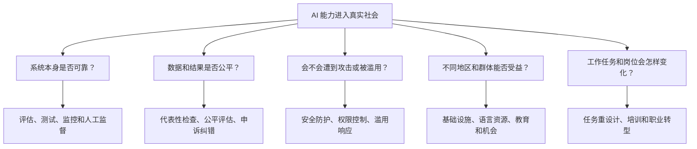
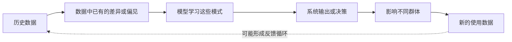
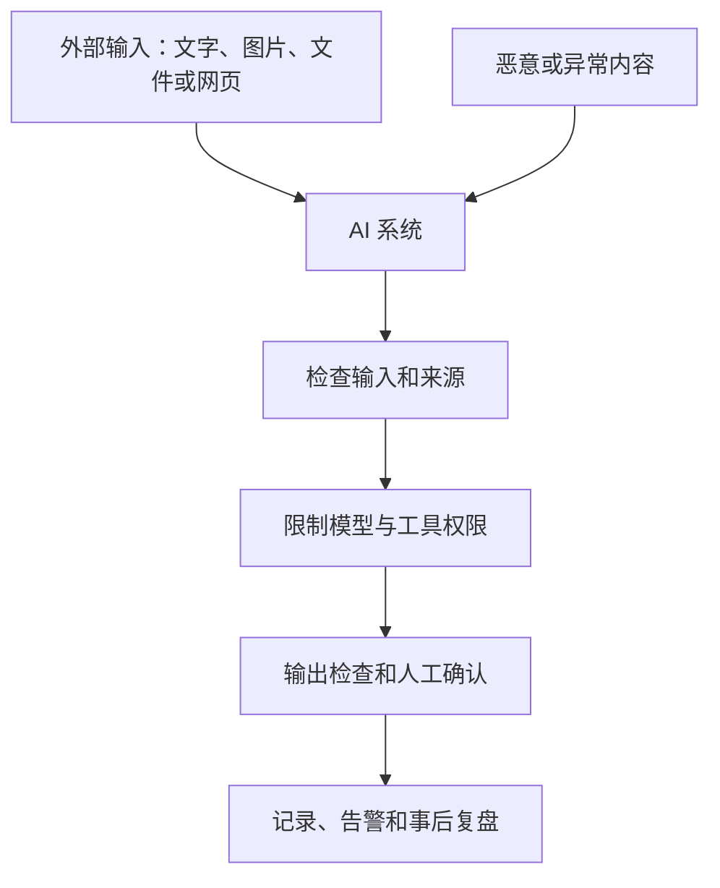
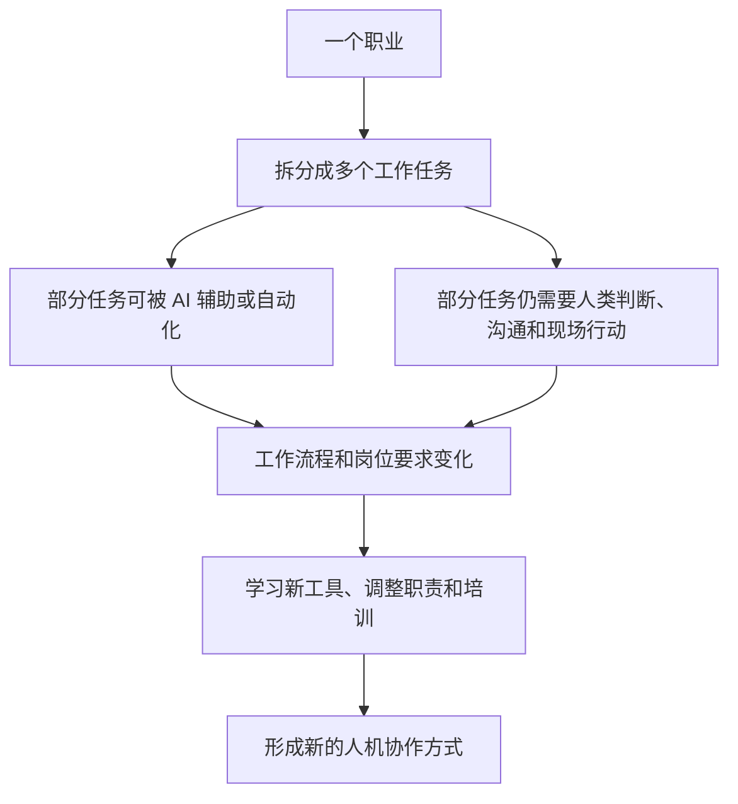

# 模块四知识地图：理解 AI 的风险、社会影响与未来工作

> 对应课程：吴恩达《AI For Everyone》模块四，第 28—35 节  
> 整理日期：2026-11-07  
> 适用对象：希望安全、理性地使用 AI，并理解 AI 对社会和工作的影响的普通学习者

## 一、先看全貌：AI 不只是技术问题，也是社会问题

**本模块的核心问题：不只问 AI 能不能做，还要问它对谁有影响、出了问题怎么办、收益和风险由谁承担。**

## 二、对 AI 保持现实认识

不要把 AI 看成万能工具，也不要因为它会犯错就否定所有用途。

判断一个 AI 系统时，至少要看：
- 它被设计来完成什么任务；
- 在什么条件下可以使用；
- 测试证据是否接近真实场景；
- 它通常会怎样出错；
- 错误会带来多大影响；
- 是否有人监督、纠正和承担责任。

**模型能力强，不代表每一次回答都可靠。** 现代 AI 可能完成复杂任务，也可能在简单问题或多步骤流程中犯错。要按具体用途测试，而不是只看演示和宣传。

## 三、偏见与歧视：数据可能把旧问题带进新系统

例如，某公司用过去的招聘记录训练筛选系统。如果过去的招聘偏向某类候选人，模型可能把这种历史倾向学进去，并继续给其他候选人较低评价。

降低偏见风险可以：
1. 检查数据从哪里来，是否覆盖不同群体；
2. 检查标签和评价标准是否合理；
3. 分群体测试系统表现，而不只看总体平均分；
4. 邀请领域专家和受影响者参与检查；
5. 提供人工复核、申诉和纠错渠道；
6. 上线后持续观察结果是否发生变化。

公平不是只在训练结束时检查一次，而是贯穿设计、测试和实际使用。

## 四、对抗攻击：有人可能故意让 AI 出错

普通错误可能来自数据不足、模型能力限制或环境变化；对抗攻击则是有人有意构造输入，试图诱导系统产生错误或违反规则。

常见风险包括：
- **规避攻击：** 故意改变输入，让识别系统判断错误；
- **数据投毒：** 把有问题的样本混入训练数据；
- **提示注入：** 在文档、网页或用户输入中藏入指令，试图影响 AI 的行为；
- **权限滥用：** 利用 AI 连接的工具做出未经允许的操作。

防护不能只依靠一句“请忽略恶意指令”。还需要权限最小化、可信来源管理、工具调用确认、日志记录、测试和应急处理。

## 五、AI 的有害使用：风险不只来自模型

AI 可能被用于诈骗、冒充他人、深度伪造、虚假评论、骚扰、隐私侵犯和虚假信息传播。

个人可以：
- 对要求转账、验证码或紧急付款的消息保持警惕；
- 用其他可信渠道核实熟人或机构的身份；
- 不随意上传他人的隐私资料；
- 不把声音、视频或图片当作身份真实性的唯一证据；
- 发现冒用或诈骗时保留证据并向平台或相关机构报告。

组织可以建立使用规范、访问控制、滥用监测、投诉渠道和事件响应机制。

## 六、AI 与发展中经济体：机会不会自动平均分配

AI 可能帮助教育、医疗、农业、小企业和公共服务，但不同地区能否获得收益，取决于多种条件：

- 网络、电力和设备等基础设施；
- 当地语言的数据和服务；
- 教育、培训和数字技能；
- 适合本地需求的产品；
- 个人数据和公共数据的治理；
- 技术收益是否能被当地企业和劳动者分享。

如果只有少数地区拥有算力、人才和高质量数据，AI 可能扩大已有差距。因此，发展机会不仅是“有没有模型”，还包括能否接入、理解、负担和有效使用。

## 七、AI 与就业：先看任务怎样变化，不要急着判断职业消失

一个岗位通常由许多任务组成。AI 可能先改变其中一部分，例如整理资料、生成初稿、归纳信息或处理重复录入；人仍需要设定目标、判断例外情况、沟通、承担责任和处理复杂现场问题。

个人可以：
- 学会使用与自己工作相关的 AI 工具；
- 加强领域知识、判断力、沟通和协作；
- 练习检查 AI 输出，而不是只会复制答案；
- 关注岗位中哪些任务正在变化；
- 通过培训和实践调整能力结构。

组织也应提供培训、转岗支持，并关注自动化收益和成本如何分配。

## 八、负责任使用 AI：一张日常检查清单

在使用 AI 处理重要任务前，问自己：

1. **准确吗？** 关键事实、数字和来源是否核对？
2. **公平吗？** 是否可能对某些人群产生不合理影响？
3. **安全和隐私吗？** 是否上传了不该公开的个人或公司信息？
4. **有权限吗？** AI 是否被允许访问这些文件、账号和工具？
5. **可追溯吗？** 是否保留来源、修改记录和关键决策依据？
6. **有人负责吗？** 出错时谁来检查、纠正和承担后果？

高影响场景，例如招聘、贷款、医疗、教育机会和重要公共服务，应有更严格的专业评估、透明流程、人工监督和申诉渠道。

## 九、用日常案例理解四类风险

| 场景 | 可能的问题 | 更安全的做法 |
|---|---|---|
| AI 帮忙筛选简历 | 历史招聘偏见被延续 | 分群体检查结果，人工复核 |
| AI 阅读网页并操作软件 | 网页藏有恶意指令 | 不把网页内容当成可信命令，限制工具权限 |
| AI 生成亲友语音或视频 | 被用于冒充和诈骗 | 通过已知电话或其他渠道确认身份 |
| AI 辅助完成工作 | 错误内容被直接发给客户 | 关键事实核查，外发前由人确认 |
| AI 进入教育或医疗 | 错误影响重要权益 | 专业人员监督，测试真实环境表现 |

## 十、从第 28 节到第 35 节：每节在地图中的位置

| 视频 | 学到什么 | 在地图中的作用 |
|---|---|---|
| 28 第四周导论 | AI 对社会的广泛影响 | 建立责任视角 |
| 29 对 AI 保持现实认识 | 能力、限制和可解释性 | 理性判断系统 |
| 30 歧视与偏见 | 数据和算法中的不公平 | 关注公平 |
| 31 对抗攻击 | 恶意输入和系统防护 | 关注安全 |
| 32 AI 的有害使用 | 欺诈、深度伪造和隐私侵犯 | 关注滥用 |
| 33 AI 与发展中经济体 | 基础设施、机会和数字鸿沟 | 关注社会公平与发展 |
| 34 AI 与就业 | 任务自动化、增强和岗位变化 | 关注工作转型 |
| 35 课程总结 | 四周内容整合和个人行动 | 把认识转为实践 |

## 十一、最容易混淆的六件事

1. **模型错误不一定都是攻击。** 普通失误与恶意诱导的原因不同，防护方法也不同。
2. **总体准确率高不代表对每个群体都公平。** 必须检查不同人群的实际结果。
3. **有 AI 能力不等于有安全保障。** 还需要权限、测试、监控和责任机制。
4. **AI 会改变任务，不等于整个职业立刻消失。** 要具体分析岗位由哪些任务组成。
5. **技术可用不等于人人受益。** 基础设施、语言、成本和教育会影响受益机会。
6. **人类监督不等于走形式。** 审核者必须有能力理解结果、发现问题并真正叫停系统。

## 十二、自测题

- 为什么 AI 系统可能把历史社会偏见带入新的决策？
- 对抗攻击和普通模型错误有什么不同？
- 提示注入为什么会成为连接外部工具的 AI 系统风险？
- AI 对发展中地区带来机会的同时，为什么也可能扩大差距？
- 为什么分析 AI 对就业的影响时，要先拆分工作任务？
- 哪些场景应该保留人工审核和申诉渠道？

## 十三、课程原意与现代补充的边界

本地图归纳第 28—35 节的现实预期、偏见、对抗攻击、有害使用、发展中经济体、就业和课程总结。提示注入、现代 Agent 权限管理、当前生成式 AI 安全评估等属于课程之后的补充，不应误认为是原视频逐字讲授的内容。

## 相关笔记

- [模块四：AI 与社会](04-AI与社会.md)
- [视频 28—35 逐课笔记](README.md)
- [35 节逐课学习清单](05-35节逐课学习清单.md)
- [模块三知识地图](09-第三模块知识地图.md)
