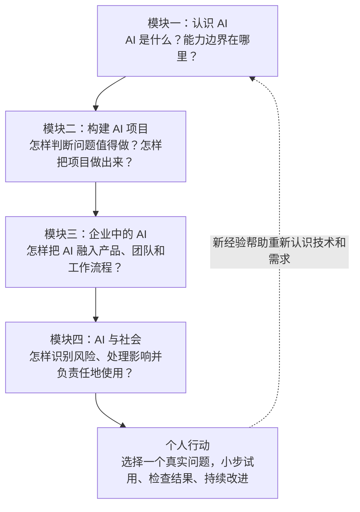
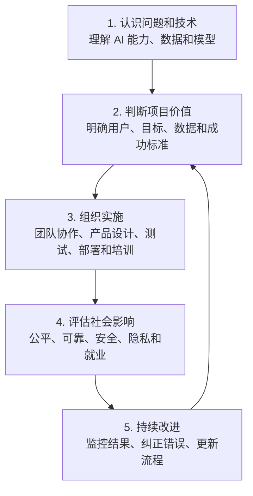
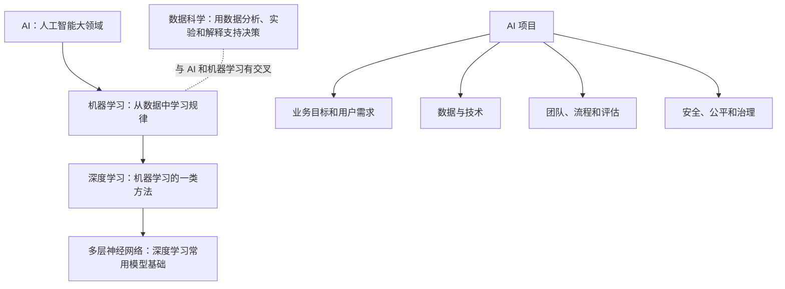

# 《AI For Everyone》全课程总知识地图

> 对应吴恩达《AI For Everyone》完整课程：四个模块、35 节视频  
> 整理日期：2026-11-07  
> 适用对象：希望先掌握整门课程全貌，再按模块深入学习的普通学习者

## 一、先看一张总图：整门课程从“理解 AI”走向“负责任地使用 AI”

这四个模块不是四堆互不相关的知识，而是一条逐步深入的路线：

1. 先认识 AI，知道它能做什么、不能做什么。
2. 再学习怎样把一个实际问题变成可测试的 AI 项目。
3. 接着理解 AI 怎样进入企业产品、团队和日常流程。
4. 最后考虑公平、安全、社会影响和工作变化。

**整门课程的主线：理解技术 → 选择问题 → 落地应用 → 负责任地使用。**

## 二、四个模块分别回答什么问题？

| 模块 | 核心问题 | 学完应该具备的认识 |
|---|---|---|
| 一、认识 AI（第 1—9 节） | AI 是什么？机器怎样从数据中学习？ | 能分清 AI、机器学习、深度学习、神经网络和数据科学等概念 |
| 二、构建 AI 项目（第 10—17 节） | 怎样判断一个想法值得做，并把项目推进？ | 能拆解问题、判断数据条件、理解项目流程和团队合作 |
| 三、企业中的 AI（第 18—27 节） | 怎样把 AI 放进真实产品和组织？ | 能理解 AI 产品的多个环节、团队角色、试点和组织转型 |
| 四、AI 与社会（第 28—35 节） | AI 会带来哪些风险和社会变化？ | 能识别偏见、安全、滥用、发展机会和就业变化问题 |

## 三、四个模块怎样连接起来？

这条路线可以套用到很多现实问题，例如公司希望用 AI 帮助客服、个人希望用 AI 整理学习资料，或者学校希望改善学习支持服务。

- 模块一帮助你判断：AI 是否适合这个任务？
- 模块二帮助你判断：项目目标、数据和验收标准是什么？
- 模块三帮助你判断：需要哪些人、软件和流程配合？
- 模块四帮助你判断：错误、公平、隐私和安全风险如何控制？

## 四、用一个贯穿四个模块的案例：建立个人学习资料库

假设你有很多课程视频、PDF、网页收藏和零散笔记，希望把它们整理成以后能查找、复习和提问的知识库。

### 模块一：先理解工具的能力

- AI 可以帮助阅读、归纳、分类和回答问题。
- 机器学习和深度学习是 AI 的部分技术路线，并非所有整理任务都需要自己训练模型。
- 输出可能有错误，不能把 AI 的回答自动当成事实。

### 模块二：把想法变成小项目

- 明确目标：资料能分类、搜索、复习，并能追溯来源。
- 明确输入：PDF、网页、视频字幕、个人笔记。
- 明确输出：摘要、知识点、标签、复习题和索引。
- 先选一小批资料试做，检查准确率、遗漏和整理时间。
- 通过后再逐步扩大，不要一开始就批量覆盖原文件。

### 模块三：把 AI 融入工作流程

- ChatGPT 可以协助阅读、解释、归纳和规划。
- Codex 等执行工具可以在授权范围内帮助整理文件、修改项目内容和检查结果。
- GitHub 可以保存知识库、目录和修改历史。
- 需要明确每一步由谁执行、怎样检查、结果放在哪里。

### 模块四：检查风险和长期影响

- 不上传密码、验证码、证件号码或不该公开的私人资料。
- AI 生成的知识点要核对原文，保留出处。
- 文件移动、覆盖和删除等重要操作要人工确认。
- 不要让错误摘要在没有核实的情况下继续传播。
- 定期检查资料是否过时、链接是否失效。

这个案例说明：真正有价值的 AI 使用，不是单纯得到一段漂亮答案，而是建立一个可检查、可持续、能解决实际问题的流程。

## 五、全课程关键概念关系

请记住：这张图是入门理解图。AI、机器学习、数据科学在现实工作中的定义边界会因场景而不同；数据科学也不只是 AI 的子集。

## 六、课程学习顺序：先建立框架，再逐节深入

| 学习阶段 | 对应内容 | 建议关注 |
|---|---|---|
| 第一步 | 第一模块知识地图 + 第 1—9 节 | 概念、数据、模型和能力边界 |
| 第二步 | 第二模块知识地图 + 第 10—17 节 | 项目流程、项目选择、数据和团队 |
| 第三步 | 第三模块知识地图 + 第 18—27 节 | 产品、组织转型、角色和实际应用 |
| 第四步 | 第四模块知识地图 + 第 28—35 节 | 风险、公平、安全、社会和就业 |
| 第五步 | 个人 AI 实践手册 | 把知识应用到自己的学习和工作 |

建议每学完一个模块，先尝试用自己的话回答三个问题：
- 这个模块最重要的观点是什么？
- 它能帮助我解决什么实际问题？
- 我应该怎样检查 AI 是否做对了？

## 七、整门课程最值得记住的十条原则

1. 不要把 AI 当成万能工具，先看任务是否适合。
2. 不要为了使用 AI 而使用 AI，先明确真实问题。
3. 数据质量和代表性会影响结果。
4. 模型训练只是项目的一部分，部署、用户体验和维护同样重要。
5. 先做小范围试点，再决定是否扩大。
6. 业务人员和技术人员需要共同确定目标与验收标准。
7. AI 应融入完整工作流程，而不是只做一个孤立演示。
8. 对重要事实、数字和来源进行核查。
9. 对隐私、偏见、安全和恶意使用保持警惕。
10. AI 会改变许多工作任务，持续学习和调整能力很重要。

## 八、自测：不看笔记，能否讲清楚这门课？

1. AI、机器学习和深度学习之间是什么关系？
2. 一个 AI 项目从业务问题到上线，需要经过哪些主要步骤？
3. 为什么 AI 产品通常需要多个环节和不同岗位配合？
4. 企业为什么不能只买软件就算完成 AI 转型？
5. 为什么 AI 的公平、安全、隐私和就业影响也属于 AI 学习的一部分？
6. 如果你想用 AI 整理个人资料，怎样从一个低风险的小试点开始？

如果能用自己的话回答这些问题，就已经掌握了整门课程的主干。具体细节再回到每节视频笔记复习即可。

## 九、四张模块知识地图入口

- [模块一：从认识 AI 到理解神经网络](07-第一模块知识地图.md)
- [模块二：怎样把 AI 想法变成真正有用的项目](08-第二模块知识地图.md)
- [模块三：怎样让 AI 真正进入企业和日常工作](09-第三模块知识地图.md)
- [模块四：理解 AI 的风险、社会影响与未来工作](10-第四模块知识地图.md)

## 十、课程原意与现代补充的边界

本总图归纳的是《AI For Everyone》四个模块的整体学习路线。ChatGPT、现代大语言模型、RAG、Agent、Codex 等例子用于帮助联系今天的工具环境，是后续补充，不应误认为是课程早期视频逐字讲授的内容。

具体工具功能会变化，实际操作前应查看当前产品说明和界面。学习重点应放在可长期使用的判断方法：明确目标、检查证据、控制风险、验证结果。

## 相关资料

- [课程总目录](README.md)
- [35 节逐课学习清单](05-35节逐课学习清单.md)
- [个人 AI 实践手册](个人AI实践手册/README.md)
